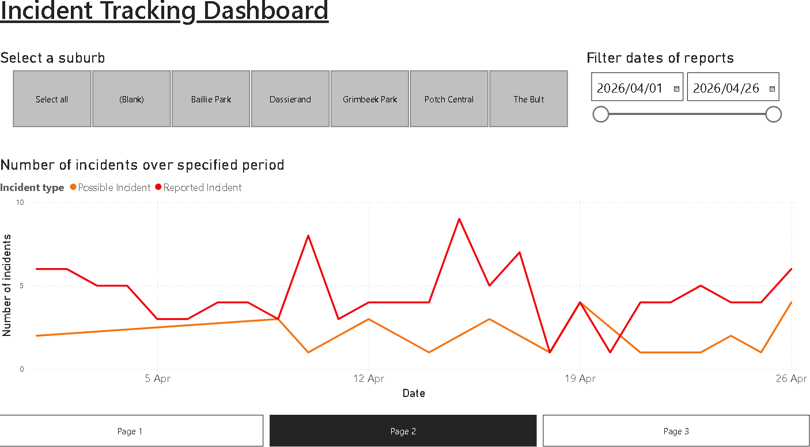
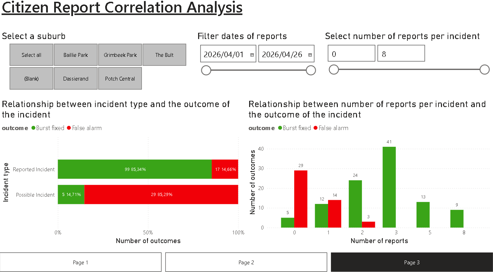

# PotchPulse: Smart Water Infrastructure Monitoring (SWIM)

A real-time streaming data platform on **Microsoft Azure** that monitors a city's water network. Simulated pressure sensors, a maintenance truck and citizen social-media reports stream through **Event Hubs** into **Stream Analytics**, are stored in **Cosmos DB**, are enriched with **AI sentiment analysis** by an **Azure Function**, and are visualised live in **Power BI** (DirectQuery).

The scenario is based on real news of pipe bursts and water outages in Potchefstroom, South Africa.


## What it does

1. **Simulation** ([`generator/potch_generator.py`](generator/potch_generator.py)). Four cooperating threads share one in-memory "city state":
   - **IoT sensors:** 15 pressure sensors across 5 suburbs. A pressure drop flags a `POSSIBLE_INCIDENT` with a physics-based confidence score (capped at 0.70). A hidden "ground truth" decides whether the pipe is actually broken, so false alarms happen too.
   - **Social media:** citizens report an incident 0–10 times, choosing random negative, neutral or positive messages. A reported incident becomes `REPORTED_INCIDENT`.
   - **Fleet:** a municipal truck is dispatched to the highest-confidence incident, drives there, and then either fixes the pipe or records a false alarm (`incident_resolution`).
   - **DB sync:** reads back the confidence scores the Azure Function updated, closing the feedback loop for dispatch decisions.
2. **Ingestion:** three Event Hubs (`iot`, `social`, `fleet`), all events carrying timestamps for correct event-time ordering.
3. **Stream processing** ([`stream-analytics/query.sql`](stream-analytics/query.sql)). One Stream Analytics job:
   - sends social reports to the AI bridge function;
   - upserts sensor telemetry and fleet positions;
   - routes `incident_resolution` events to incident history;
   - merges sensors and trucks into one map-ready container (CTE `CombinedMapData`).
4. **AI enrichment** ([`function/function_app.py`](function/function_app.py)). An HTTP-triggered Azure Function calls the **Azure AI Language** sentiment API for each report:
   - it raises the sensor's confidence score for negative reports and lowers it for positive ones;
   - it counts the reports;
   - it stores each report with its sentiment.
5. **Storage:** Cosmos DB (NoSQL), with six containers whose partition keys are chosen per access pattern: `SensorMaster`, `SensorTelemetry`, `Fleet`, `IncidentHistory`, `SocialMediaReports` and `UnifiedLocations`.
6. **Analytics:** a three-page Power BI report over Cosmos DB with DirectQuery ([`powerbi/`](powerbi/)):
   - a live command-centre map;
   - incident trends over time;
   - a correlation of citizen reports with incident outcomes.

## Dashboard

| Command centre (live map) | Incident tracking | Citizen report correlation |
|---|---|---|
|  |  |  |

## Tech stack

| Layer | Azure service / technology |
|---|---|
| Data generation | Python 3 (threads), `azure-eventhub`, `azure-cosmos`; ran on an Azure VM |
| Ingestion | Azure Event Hubs (3 hubs) |
| Stream processing | Azure Stream Analytics (SQL-like query, event-time with `TIMESTAMP BY`) |
| AI | Azure AI Language (Microsoft Foundry) sentiment analysis, called from an Azure Function (Python, HTTP trigger) |
| Storage | Azure Cosmos DB for NoSQL |
| Visualisation | Power BI Desktop, DirectQuery via the Cosmos DB v2 connector |

## Repository layout

```text
generator/            simulator (potch_generator.py), historical-data generator and loader
  data/               generated historical incidents and social reports (for backfilling the dashboards)
function/             Azure Function "AI bridge" (sentiment -> confidence score)
stream-analytics/     Stream Analytics job query
powerbi/              Power BI report (.pbix)
docs/                 setup guide (SETUP.md), full project write-up (REPORT.md) and images
```

## Running it

Running it needs your own Azure resources. The original ones were on an Azure for Students subscription in Italy North and no longer exist.

**[docs/SETUP.md](docs/SETUP.md) is the full step-by-step guide.** It covers the resources and tiers, the portal steps, the Stream Analytics inputs and outputs, Power BI, troubleshooting and cleanup. In short:

1. **Create** a resource group with:
   - a Cosmos DB for NoSQL account (serverless);
   - an Event Hubs namespace with the three hubs, a Send policy and a Listen policy.
2. **Initialise Cosmos DB:** in `generator/`, copy `.env.example` to `.env`, fill it in, and run:

   ```bash
   pip install -r requirements.txt
   python potch_generator.py --init-only   # creates the database, the 6 containers and 15 sensors
   python load_history.py                  # optional: backfill history for the trend pages
   ```

3. **Create** an Azure AI Language resource (free F0) and a Python 3.11 Function App. Set `AI_ENDPOINT`, `AI_KEY`, `COSMOS_URI`, `COSMOS_KEY` and `COSMOS_DB` as app settings, then deploy [`function/`](function/).
4. **Create the Stream Analytics job:**
   - inputs `iot-stream`, `social-stream` and `fleet-stream`;
   - outputs `out-aibridge` and `out-cosmos-*`, with Document id `id`;
   - paste [`stream-analytics/query.sql`](stream-analytics/query.sql) and start the job.
5. **Run** `python potch_generator.py`, then open [`powerbi/PotchPulse-Dashboard.pbix`](powerbi/) and point it at your Cosmos DB account.

Secrets are read from environment variables or a local `.env` file only. Both `.env` and `local.settings.json` are git-ignored. The keys in the `.example` files are random placeholders in the right format, not real credentials.

## Documentation

[docs/SETUP.md](docs/SETUP.md) is the deployment guide. [docs/REPORT.md](docs/REPORT.md) is the full write-up. It covers:

- the problem definition and data-generation realism;
- the UML architecture;
- the Cosmos DB schema and partition-key choices;
- the Event Hubs design;
- the Stream Analytics query, inputs and outputs;
- the Power BI insights;
- observability, performance and cost.

Built for ITRI613 (Databases I).
