# PotchPulse: Smart Water Infrastructure Monitoring (SWIM)

**Author:** Meiring van Niekerk · ITRI613 Databases I

This is the project write-up. For a quick overview and setup steps, see the [main README](../README.md).

## Problem definition

South Africa's Potchefstroom faces many challenges, among them water pipe bursts that cause significant problems for its citizens. Accordingly, many suburbs in Potchefstroom experience unforeseen water shortages and late notices to maintenance of water infrastructure, causing frustration (Potchefstroom Herald, 2026). Consequently, there are growing concerns about JB Marks Municipality's service delivery and interruptions to the water supply (OFM News, 2026). Therefore, it is imperative that a real-time information system be developed to monitor waterpipe pressure and detect potential pipe bursts. This enables improved decision-making for identifying potential pipe bursts, effective maintenance task scheduling with appropriate notices, and preventing frustration and pipe bursts.

## Data generation and realism

To simulate the Potchefstroom smart water sensor monitoring system, a Python script will run locally on a laptop. The [Python script](../generator/potch_generator.py) will simulate pipe bursts by generating random pressure readings from water pipe sensors. Low water pressure readings can be used to identify blockages or potential leakages in a pipeline (Tameson, 2023). If the reading falls below a certain threshold, it is flagged as a potential incident. Potential incidents can be escalated to a reported incident when 1-10 persons report on the incident via social media messages. The script will randomly determine whether a potential incident will become a reported incident and how many people will report it, while also selecting a random message from pre-selected messages to account for message sentiment analysis in incident severity. Whilst the potential and reported incidents are being generated, a truck from the JB Marks municipality will be dispatched to these destinations to repair burst pipes. It should be noted that sensor readings may be inaccurate at times due to sensor battery glitches, someone opening a fire hydrant, or a school/factory using a large amount of water, which can cause a low sensor pressure reading that triggers a false alarm.

The following sections elaborate on the schema design, how the data is processed and stored and how it is visualised in Power BI. Section 3 provides a UML architecture design for the solution. Section 4 discusses schema design. Section 5 discusses the ingestion architecture and event hubs design. Section 6 discusses real-time processing with Stream Analytics. Section 7 discusses data visualisation in Power BI. Section 8 discusses performance evaluation and costs.

## UML architecture design

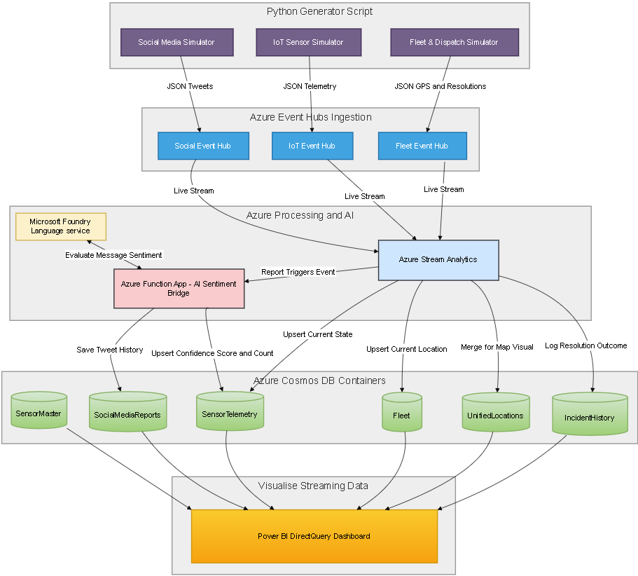

<u>  
</u>

## Schema design 

This section discusses the container schema design in Azure Cosmos DB.

### Fleet Container

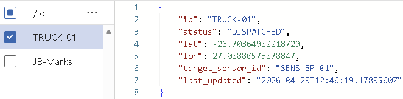

The fleet container contains information about the municipality buildings and vehicle teams dispatched to a potential or reported incident.

Partition key = id (Provides high cardinality to ensure even data distribution across physical partitions)

| **Field**        | **Description**                                                                                                                                                                                |
|------------------|------------------------------------------------------------------------------------------------------------------------------------------------------------------------------------------------|
| id               | Uniquely identifies the vehicle or building.                                                                                                                                                   |
| status           | Describes what the vehicle is doing.                                                                                                                                                           |
| lat and lon      | Coordinates of the current location.                                                                                                                                                           |
| target_sensor_id | Identifies the sensor the vehicle is heading towards.                                                                                                                                          |
| last_updated     | States how up to date the location is. Azure Stream Analytics uses this field in the TIMESTAMP BY clause to process live streams in correct chronological order and handle late-arriving data. |

### SensorMaster Container

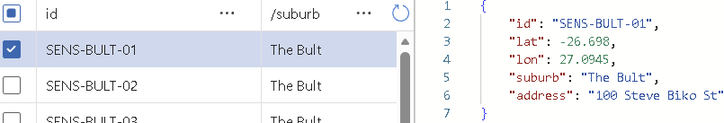

The SensorMaster container contains static sensor data that rarely changes. This data is uploaded to the container once, using a JSON file.

Partition key = suburb (Improves reading speeds when searching for all sensors in a certain suburb)

| **Field**   | **Description**                            |
|-------------|--------------------------------------------|
| id          | Uniquely identifies the sensor.            |
| lat and lon | Coordinates of the sensor’s location.      |
| suburb      | The suburb in which the sensor is located. |
| address     | The physical address of the sensor.        |

### SensorTelemetry Container

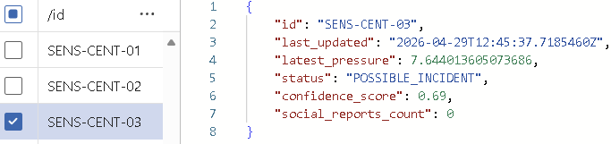

The SensorTelemetry container contains frequently updated sensor data. This data is not in the SensorMaster container because when Azure Stream Analytics writes an event to a Cosmos DB output, it performs an **Upsert (Replace)** operation, not a "Patch" (partial update) operation. This means you would have to replace all static data with every update, even if only the pressure reading changes.

Partition key = id (Optimises for point reads. When the dashboard needs to update a specific sensor's state, querying by id is the fastest)

| **Field**            | **Description**                                                                                                                                                                                                                                                   |
|----------------------|-------------------------------------------------------------------------------------------------------------------------------------------------------------------------------------------------------------------------------------------------------------------|
| id                   | Uniquely identifies the sensor.                                                                                                                                                                                                                                   |
| last_updated         | States how up to date the sensor reading is. Azure Stream Analytics relies on this field to maintain time-series accuracy and handle event ordering in the background.                                                                                            |
| latest_pressure      | The sensor’s current pressure reading.                                                                                                                                                                                                                            |
| status               | Describes the sensor’s state.                                                                                                                                                                                                                                     |
| confidence_score     | How confident the municipality is that there is in fact a pipe burst. The confidence score for reported incidents is higher than for possible incidents, based on the number of people who report the incident and the sentiment analysis of each report message. |
| social_reports_count | Real-time count of citizen reports for this specific sensor.                                                                                                                                                                                                      |

### IncidentHistory Container

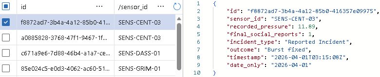

The IncidentHistory container contains incident history information for all sensors.

Partition key = sensor_id (Facilitates efficient grouping. It allows Power BI to quickly retrieve the entire history of a specific pipe without scanning the whole database)

| **Field**            | **Description**                                                                                                           |
|----------------------|---------------------------------------------------------------------------------------------------------------------------|
| id                   | Uniquely identifies the historical record.                                                                                |
| sensor_id            | Links the record to a specific physical sensor.                                                                           |
| recorded_pressure    | The pressure recorded at the exact moment the incident was resolved.                                                      |
| final_social_reports | How many people reported this incident.                                                                                   |
| incident_type        | Identifies whether it was a possible or reported incident.                                                                |
| outcome              | Was the burst identified and fixed or was it a false alarm.                                                               |
| timestamp            | The exact date and time at which the fleet truck resolved/closed the incident.                                            |
| date_only            | Used for time series analysis of incidents over time. timestamp is not compatible for this using DirectQuery in Power BI. |

### SocialMediaReports Container

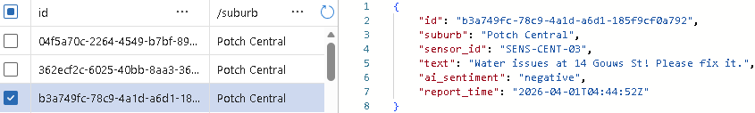

The SocialMediaReports container contains report information for reported incidents.

Partition key = suburb (Improves reading speeds for social media queries per region)

| **Field**    | **Description**                                                                                  |
|--------------|--------------------------------------------------------------------------------------------------|
| id           | Uniquely identifies each report.                                                                 |
| suburb       | The suburb in which the report is made.                                                          |
| sensor_id    | Identifies the sensor for which the report is made.                                              |
| text         | The report message.                                                                              |
| ai_sentiment | Sentiment analysis of the report message is conducted by the Microsoft Foundry Language Service. |
| report_time  | When the report was made.                                                                        |

### UnifiedLocations Container

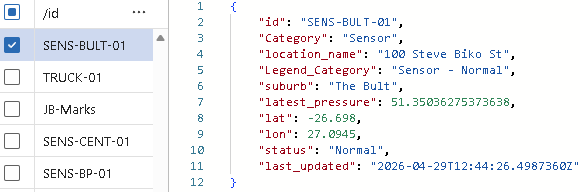

The UnifiedLocations container contains information used to visualise sensors, trucks, and municipal buildings on a map in Power BI.

Partition key = id (Supports the Merge/Join logic in Stream Analytics, allowing sensors and trucks to be updated independently within the same map-ready container)

| **Field**       | **Description**                                                                                                         |
|-----------------|-------------------------------------------------------------------------------------------------------------------------|
| id              | Uniquely identifies the entity.                                                                                         |
| Category        |  Identifies if the object is a 'Sensor' or 'Fleet'.                                                                     |
| location_name   | Address (for sensors) or Truck/Building Name (for fleet).                                                               |
| Legend_Category | The legend used to visualise the entity on the map in Power BI.                                                         |
| suburb          | The suburb in which the entity is located. Null if it is a fleet object.                                                |
| latest_pressure | Current pressure (null for fleet objects).                                                                              |
| lat and lon     | Coordinates of the entity’s location.                                                                                   |
| status          | Identifies the entity’s state.                                                                                          |
| last_updated    | Ensures the map reflects the entity's latest state by allowing Stream Analytics to discard older, out-of-order packets. |

## Ingestion architecture and Event Hubs design

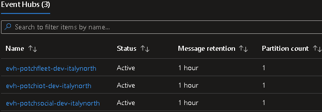

In terms of ingestion, the Python script has separate threads for water sensors, social media reports and fleet dispatch. It also has a final database thread that reads from the database to fetch **confidence_score** values generated by the Azure Function App.

The Python Script also uses a shared object named **CITY_STATE** to allow threads to communicate with one another. For example, the Social Media thread looks at the IoT thread’s private data to decide which sensor to complain about. This shared memory is needed to ensure that citizens only complain about actual anomalies. Accordingly, data is generated in parallel to the following event hubs:

### evh-potchfleet-dev-italynorth

The **evh-potchfleet-dev-italynorth** event hub captures movement and final job reports from the fleet thread. This hub handles 2 event types, distinguished by the **event_type** tag. Stream Analytics uses this tag to route ‘gps_update’ events to the **Fleet** container and ‘incident_resolution’ events to the **IncidentHistory** container.

<table>
<colgroup>
<col style="width: 50%" />
<col style="width: 50%" />
</colgroup>
<thead>
<tr class="header">
<th>

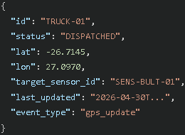

Figure 1: event_type = gps_update
</th>
<th>

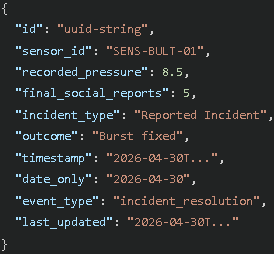

Figure 2: event_type = incident_resolution
</th>
</tr>
</thead>
<tbody>
</tbody>
</table>

### evh-potchiot-dev-italynorth

The IoT sensor thread writes sensor readings to the **evh-potchiot-dev-italynorth** event hub. This simulates the sensor's pressure reading being updated in real time. If the pressure is below a certain threshold, the status changes to ‘POSSIBLE_INCIDENT’. While the IoT stream provides pressure and confidence scores, the simulator maintains a 'Hidden Ground Truth' (**actually_broken**). This allows the system to simulate false alarms, here the pressure drops and people complain, but the truck arrives to find the pipe is actually fine.

The social media thread also posts status updates to this event hub, changing the status to ‘REPORTED_INCIDENT’ when it generates a report for a particular sensor.

The fleet thread writes status resets to this event hub once it arrives at the sensor, fixes the burst pipe, or identifies a false alarm, after which the status returns to ‘OK’.

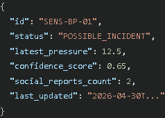

### evh-potchsocial-dev-italynorth

The social media thread writes report data to the **evh-potchsocial-dev-italynorth** event hub. This simulates a citizen filing a report for a particular sensor (Figure 1). This event hub receives variable throughput because the IoT thread, at random, may decide that a possible incident will receive between 0 and 10 reports (Figure 2). The social media thread selects report messages at random from pre-defined negative, neutral and positive messages (Figure 3). Later down the pipeline, Azure Stream Analytics sends this data to an Azure Function App, which communicates with a Microsoft Foundry language service, ultimately adjusting the confidence_score of a reported incident.

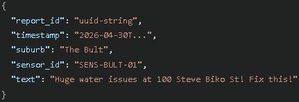

Figure : Report generated for sensor

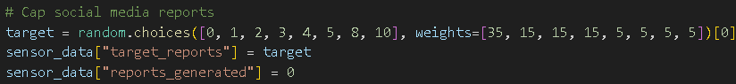

Figure : IoT thread randomly decides how many reports a sensor will get

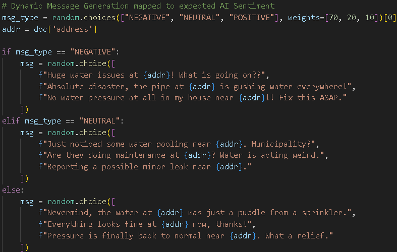

Figure : Random message selection

### Final notes

Events across all three Event Hubs include a **last_updated** or **timestamp** field. This ensures that even with network delays, Azure Stream Analytics can process events in the exact order they occurred. Additionally, a DB Sync thread allows the simulator to close the feedback loop, enabling the fleet dispatch logic to act upon the updated confidence scores stored in Cosmos DB. This is modified by the Azure Function App after sending report messages to the Microsoft Foundry language service, ultimately updating the confidence_score of a reported incident.

## Stream processing design

Azure Stream Analytics is used to analyse and transform streaming data from input event hubs into data stored in Azure Cosmos DB. This section discusses the inputs, query and output sources of the **asa-potchpulse-dev-italynorth** stream analytics job.

### Inputs

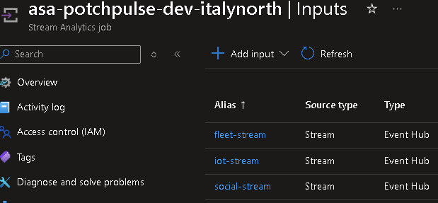

The **fleet-stream** input is connected to the **evh-potchfleet-dev-italynorth** event hub.

The **iot-stream** input is connected to the **evh-potchiot-dev-italynorth** event hub. Lastly, the **social-stream** input is connected to the **evh-potchsocial-dev-italynorth** event hub.

### Query

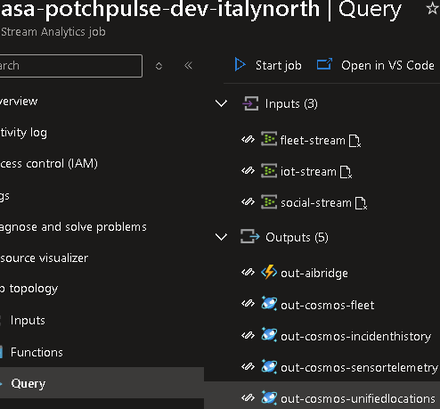

The query is extensive and can be viewed [here](../stream-analytics/query.sql). It receives the **fleet-stream**, **iot-stream**, and **social-stream** as inputs and does the following:

1.  Routes the **social-stream** to the **out-aibridge** output (Figure 1) which is an Azure Function App as discussed in the outputs section below.

2.  Routes the **iot-stream** to the **out-cosmos-sensortelemetry** output (Figure 2).

3.  Creates a Common Table Expression called **CombinedMapData** which aggregates the **iot-stream** and **fleet-stream** data together (view lines 1-67 of query file), then sends it to the **out-cosmos-unifiedlocations** output (Figure 4).

4.  Routes the **fleet-stream** to the **out-cosmos-fleet** output (Figure 3) if the event_type is ‘gps_update’, else it routes it to the **out-cosmos-incidenthistory** output (Figure 5) if the event_type is ‘incident_resolution’.

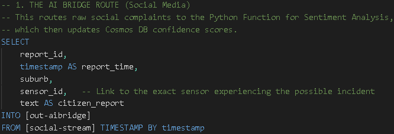

Figure 1: social-stream to out-ai-bridge

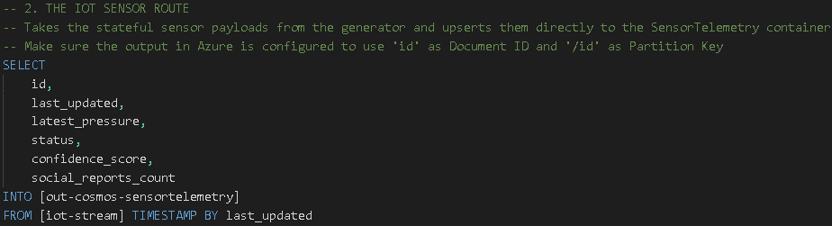

Figure 2: iot-stream to out-cosmos-sensortelemetry

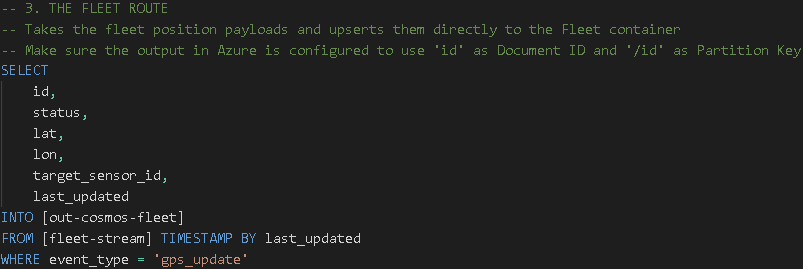

Figure 3: fleet-stream to out-cosmos-fleet

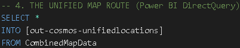

Figure 4: CombinedMapData to out-cosmos-unifiedlocations

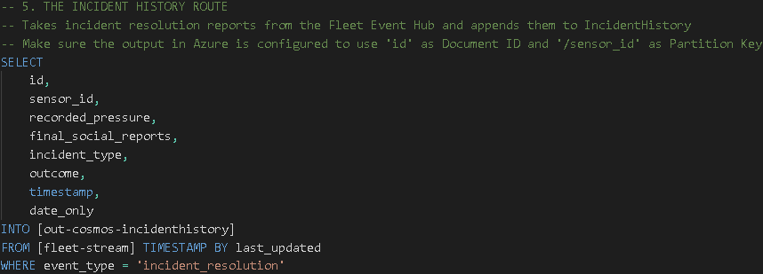

Figure 5: fleet-stream to out-cosmos-incidenthistory

### Outputs

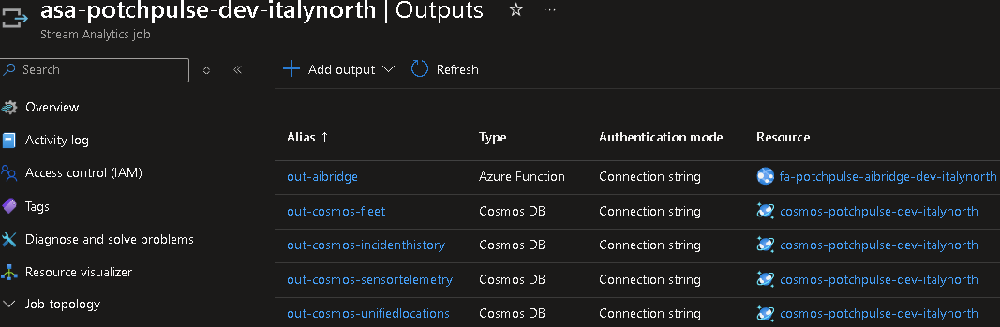

The **out-cosmos-fleet** output is connected to the **Fleet** container in Azure Cosmos DB.

The **out-cosmos-incidenthistory** output is connected to the **IncidentHistory** container in Azure Cosmos DB.

The **out-cosmos-sensortelemetry** output is connected to the **SensorTelemetry** container in Azure Cosmos DB.

The **out-cosmos-unifiedlocations** output is connected to the **UnifiedLocations** container in Azure Cosmos DB.

The **out-aibridge** is connected to an Azure Function App named **fa-potchpulse-aibridge-dev-italtynorth**, which has an HTTP trigger. The Python script for the function is available [here](../function/function_app.py). As mentioned previously, the **social-stream** is routed to the **out-aibridge** output. This means that this Azure Function App receives the social media reports from the **evh-potchsocial-dev-italynorth** event hub. Consequently, the Azure Function App receives these report messages and sends them to a Microsoft Foundry language service called **lang-potchpulse-dev-italynorth** (Figure 1), which analyses their sentiment. Accordingly, the function adjusts the incident's confidence_score based on the sentiment of each report message and updates the **SensorTelemetry** container with the adjusted confidence_score (Figure 2). Additionally, the report message, including the sentiment value (negative, neutral, or positive), is written to the **SocialMediaReports** container (Figure 3).

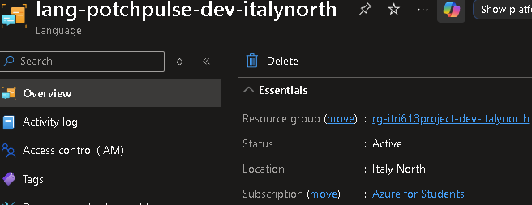

Figure 1: Microsoft Foundry language service

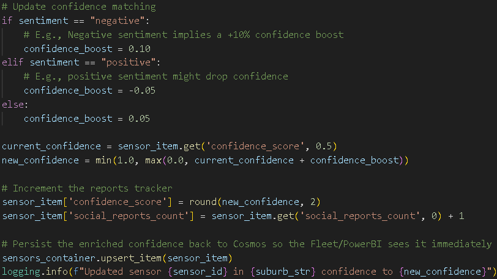

Figure 2: Azure Function App updates the confidence_score of the sensor in the SensorTelemetry container

Figure 3: Azure Function App writes the report with the sentiment value to the SocialMediaReports container

## Power BI real-time analytics and actionable insights

To enable real-time analytics, Power BI was configured with DirectQuery to retrieve data from Azure Cosmos DB via the Azure Cosmos DB v2 connector. Actionable insights can be made from the three following pages:

### Page 1

The Power BI map visualises the sensor, the municipality building, and the truck’s location. It also indicates the status of each sensor, whether it is a potential or reported incident. The pie chart shows the overall status of all sensors in Potchefstroom. The 100% stacked bar chart shows the status for all sensors in each suburb. The municipality can use this information to effectively coordinate repair teams with sensors that have been reported as faulty or show potential for leaks or pipe bursts.

### Page 2

Includes a line chart to enable time-series analysis of incidents over a period. There are a suburb and a start and end date filter to adjust the viewing to specific incidents. The municipality can use this information to identify periods when potential incidents and reported incidents were highest. Consequently, they can investigate and determine why there were so many incidents during a particular period.

### Page 3

Shows the relationship between incident type and incident outcome. Effectively, the municipality can determine whether potential or reported incidents are worth investigating based on the number of pipe-burst repairs needed upon arrival at the incident location. The relationship between the number of reports per incident and the incident's outcome is also shown. The municipality can use this information when deciding where to dispatch a repair team first (the higher the number of incident reports at a particular sensor location, the more likely there is an actual problem).

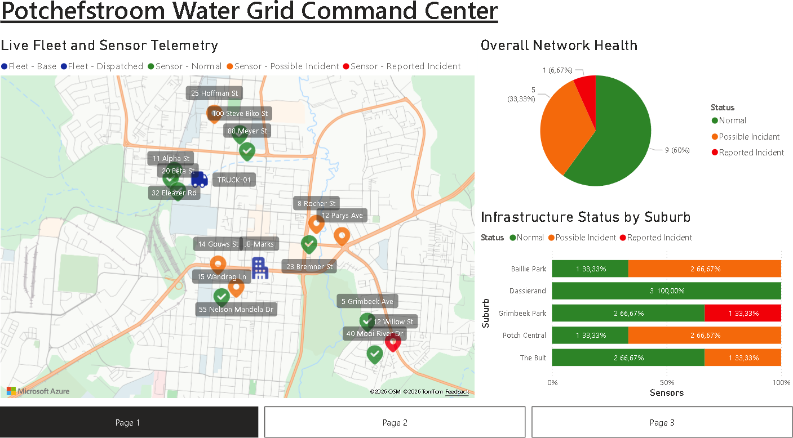

## Observability, performance evaluation, and cost awareness

### Observability and performance

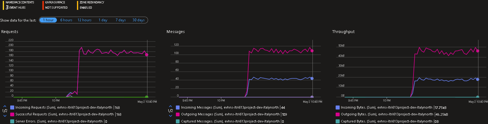

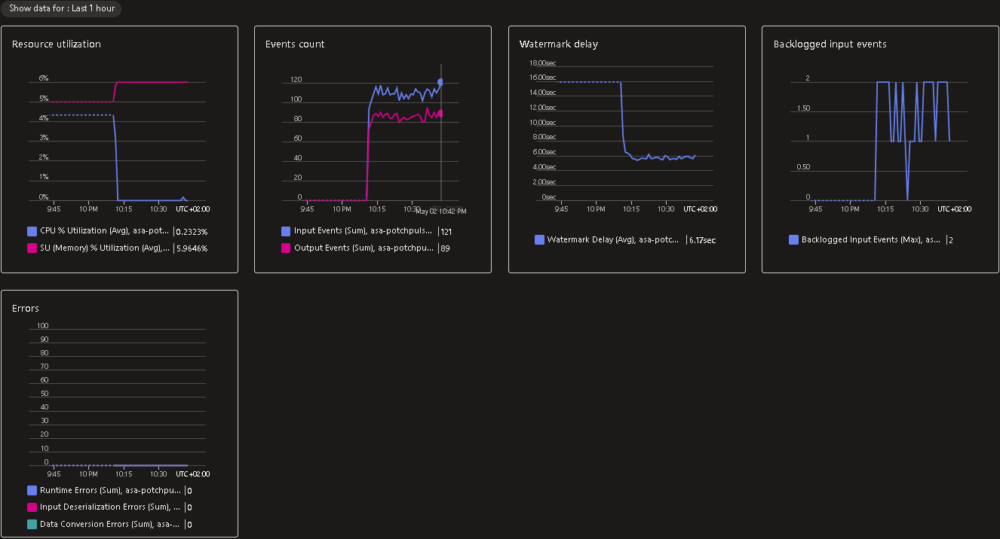

The Event Hub Namespace shows a 1:2.5 input-to-output ratio. This is because there are multiple consumer groups. For example, Fleet Hub data is used to upsert the current location of a truck in the Fleet container and to merge the map visual in the UnifiedLocations container in Azure Cosmos DB.

### Cost

Unfortunately, an Azure policy assignment on my Azure for Students subscription limited the regions where I could deploy resources. From the available regions, I chose Italy North because all the resources (Event hubs, Azure Stream Analytics, Azure Function App, Microsoft Foundry language service and Azure Cosmos DB) were compatible with this region. Also, having them in the same region may reduce costs and latency, as cross-region communication between resources could cause more latency and introduce extra costs (CloudMonitor, 2026; Microsoft, 2026). The Azure Stream Analytics was the most expensive service.

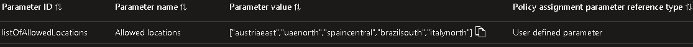

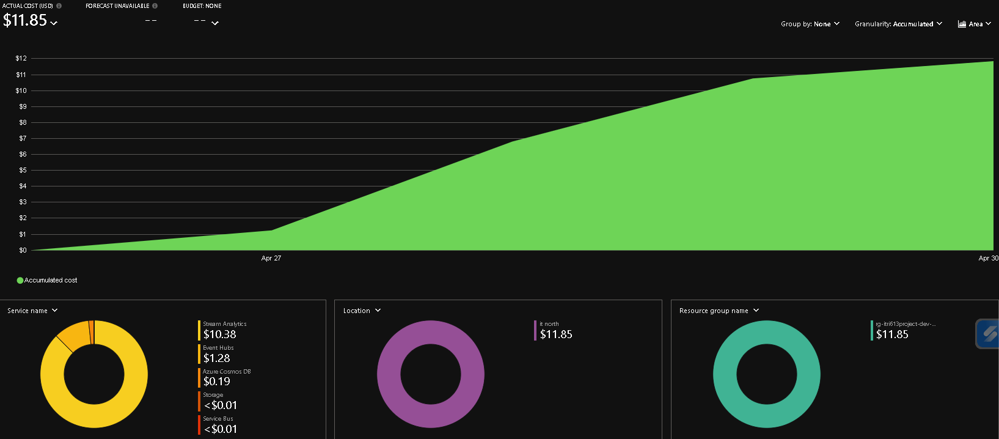

<u>  
</u>

## References

CloudMonitor. 2026. *Azure data transfer costs: everything you need to know*. <https://cloudmonitor.ai/2021/08/azure-data-transfer-costs-everything-you-need-to-know/> Date of access: 30 Apr. 2026.

Microsoft. 2026. *Azure regions and availability zones*. <https://learn.microsoft.com/en-us/azure/reliability/regions-overview> Date of access: 30 Apr 2026.

OFM News. 2026. *Potchefstroom residents face more water challenges*. <https://www.ofm.co.za/article/centralsa/340456/potchefstroom-residents-face-more-water-challenges> Date of access: 29 Apr. 2026.

Potchefstroom Herald. 2026. *Pipe burst on main water line at Lekhele Street*. <https://www.citizen.co.za/potchefstroom-herald/news/2026/04/25/pipe-burst-on-main-water-line-at-lekhele-street/> Date of access: 29 Apr. 2026.

Tameson. 2023. *Understanding Pressure Drop Formula and Significance*. <https://tameson.com/pages/pressure-drop> Date of access: 29 Apr. 2026.
